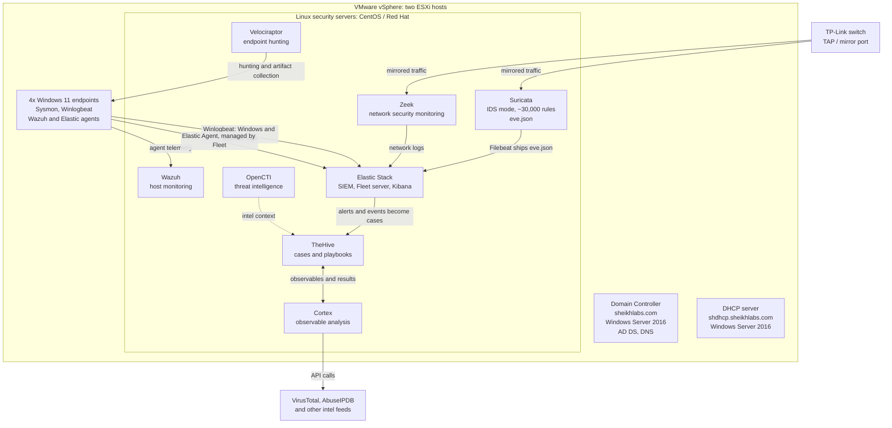

# Lab Setup

My home lab mimics a small network and security environment: a Windows domain, Linux security servers, network sensors on a tap port, and a case management layer on top. I use it to run attacks safely, watch the telemetry they generate, and turn what I see into detections.

## Diagram

## Virtualization

Everything runs on two VMware ESXi hosts managed through vSphere.

| Host | Role | Specs |
|---|---|---|
| ESXi host 1 (ESXi 6.5) | Virtualization | 192 GB RAM, 4 TB storage |
| ESXi host 2 (ESXi 6.6) | Virtualization | 192 GB RAM, 4 TB storage |
| vSphere (ESXi 6.7) | Management | Manages both hosts |

## Domain services

The lab domain is sheikhlabs.com.

| Service | Host | OS | Placement |
|---|---|---|---|
| Active Directory Domain Services, DNS | Domain controller, sheikhlabs.com | Windows Server 2016 | ESXi host 1 |
| DHCP | shdhcp.sheikhlabs.com | Windows Server 2016 | ESXi host 2 |

## Endpoints

Four Windows 11 endpoints are joined to the domain. Each endpoint runs Sysmon for detailed process, network, and file telemetry, and Winlogbeat ships the Windows and Sysmon logs into Elastic, where I review them in Kibana.

## Linux security servers

CentOS and Red Hat servers run the security stack:

- Wazuh, for agent-based host monitoring and alerting.
- Suricata and Zeek, the network sensors.
- Elastic Stack, the SIEM.
- OpenCTI, for threat intelligence context.
- TheHive, for case management.

Ansible is set up on all the servers for configuration and repeatable builds.

## Network detection

Suricata and Zeek watch the lab's traffic from a tap port I set up on my TP-Link switch, so the sensors see the traffic without sitting in the middle of it.

- Suricata runs in IDS mode, analyzing the mirrored traffic against roughly 30,000 rules in place for anomalous behavior. Its events are stored in JSON format in the eve.json file, and Filebeat forwards those logs into Elastic, where the alerts and events generated by Suricata can be reviewed.
- Zeek is configured as a network security monitoring tool, generating connection and protocol logs from the same mirrored traffic into Elastic.

Together they act as the lab's IDS layer: Suricata for signature alerts, Zeek for the network record around them.

## Host detection and the SIEM

Wazuh and Elastic Security are agent based and act as the lab's EDR layer. Elastic 8 runs with a Fleet server managing the Elastic Agents. Elastic is the SIEM for the whole lab: Filebeat delivers the Suricata and Zeek logs, Winlogbeat delivers the Windows and Sysmon logs, and the agents and Wazuh feed host telemetry into the same place. Kibana is where I visualize and search across all of it.

## Case management and enrichment

From the SIEM, events and alerts are pushed into TheHive for case management. I build playbooks in TheHive for repeatable response steps, with integrations set up for enriching data and observables.

Cortex is integrated within TheHive to run observables through analysis tools such as VirusTotal and AbuseIPDB. Cortex makes API calls to the various threat intelligence feeds and collects the results to display right inside TheHive. That intelligence around an observable helps separate immediate threats from non-immediate ones during triage.

## Threat hunting

Velociraptor is set up for threat hunting and live response on the endpoints, so I can collect artifacts and hunt across the Windows hosts when an exercise needs host-level answers the logs do not have.

## How the pieces fit together

1. Endpoints and servers generate logs and telemetry: Sysmon and Winlogbeat on Windows, agents for Wazuh and Elastic Security, eve.json from Suricata, and Zeek's network logs.
2. Filebeat, Winlogbeat, and Fleet-managed agents deliver everything into Elastic, the lab SIEM.
3. Alerts worth working are pushed from Elastic into TheHive as cases.
4. Cortex enriches the observables in each case through VirusTotal, AbuseIPDB, and other feeds.
5. Velociraptor covers endpoint hunting when a case needs a deeper look at a host.

The completed exercises from this lab are written up in the writeups section of this repo.
