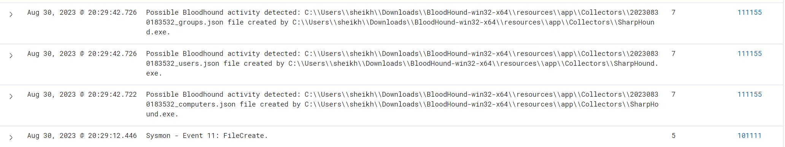
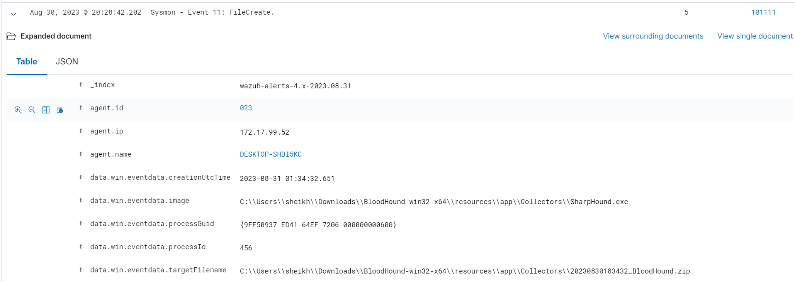

# Detecting SharpHound Active Directory Collection with Wazuh

## Summary

SharpHound is the collection tool for BloodHound. BloodHound is the analysis side: it turns directory data into a graph of users, groups, computers, sessions, ACLs, and trust relationships so an operator can see privilege escalation and lateral movement paths inside Active Directory.

That is useful for defenders when it is run deliberately. It is dangerous when an attacker gets the same map after a foothold. This lab exercise used my own SharpHound collection run as the test case. The goal was not just to run SharpHound. The goal was to make the collection visible in Wazuh, alert by alert, and then import the collected data into BloodHound to see what the attacker would learn.

The prose below uses sanitized lab placeholders. The two screenshots in the captured activity section are the original lab captures, included at my direction; they show private lab addressing and local lab machine details only.

## Lab setup

The exercise ran inside the domain side of my home lab.

| Component | Role in the exercise |
|---|---|
| VMware vSphere | Hypervisor for the lab machines. |
| pfSense | Segmentation and routing between the management, domain, and range zones. Nothing in the lab range can reach my normal network. |
| Wazuh OVA 4.4.4 | Wazuh manager, indexer, and dashboard in one VM. This was the detection and alerting console for the exercise. |
| Windows Server 2022 domain controller | Active Directory target. It hosted the domain services SharpHound queried and ran a Wazuh agent. |
| Windows endpoint | Domain-joined workstation used as the attacker foothold. SharpHound ran here in a standard user context. |
| Wazuh agents 4.4.4 | Installed on the domain controller and the Windows endpoint. The endpoint agent also collected Sysmon telemetry. |
| Sysmon | Installed on the Windows endpoint to capture process, network, and file creation telemetry, including Event ID 11 file creation events. |
| SharpHound | The collector executed on the endpoint. It queried Active Directory and wrote the collected data to JSON files and a ZIP archive. |
| BloodHound and Neo4j | Analysis stack used after collection. Neo4j stored the graph data and BloodHound visualized the imported SharpHound output. |

## Tool configuration

### Domain controller auditing

SharpHound enumeration can touch named pipes and share objects on the domain controller, including `samr`, `srvsvc`, and `lsarpc`. To make that activity visible, I enabled Windows Security Event ID 5145 on the domain controller.

Configuration changes:

1. Opened Group Policy Management on the domain controller.
2. Navigated to Computer Configuration, Policies, Windows Settings, Security Settings, Advanced Audit Policy Configuration, Audit Policies, Object Access.
3. Edited **Audit Detailed File Share**.
4. Set it to audit **Success** events.
5. Confirmed the GPO was linked and enforced for the domain controller.

Event ID 5145 records a network share object's access check. In this context, repeated 5145 events against sensitive RPC-related targets are a useful signal for null-session style enumeration against the domain controller.

### Domain controller Wazuh agent

Wazuh excludes some noisy Security events by default, including 5145. The domain controller agent configuration had to be adjusted so 5145 was not filtered out of the Security event channel query.

Configuration changes:

1. Edited the Wazuh agent configuration at `C:\Program Files (x86)\ossec-agent\ossec.conf`.
2. Removed `EventID !=5145` from the Security `eventchannel` query so those events would be collected.
3. Saved the configuration.
4. Restarted the Wazuh service.

Without that change, the GPO could generate the events and Wazuh would still drop the exact telemetry needed for the null-session rule.

### Windows endpoint Sysmon and Wazuh agent

The endpoint needed process and file telemetry, not just Windows Security events. SharpHound behavior shows up as an executable image, command line artifacts, LDAP traffic, JSON file creation, and ZIP archive creation. Sysmon gave the endpoint the file and process visibility needed for those detections.

Configuration changes:

1. Installed Sysmon from Microsoft Sysinternals with a Sysmon configuration file:

   ```powershell
   .\sysmon64.exe -accepteula -i sysmonconfig.xml
   ```

2. Added a Sysmon log collection block to the endpoint Wazuh agent configuration:

   ```xml
   <localfile>
     <location>Microsoft-Windows-Sysmon/Operational</location>
     <log_format>eventchannel</log_format>
   </localfile>
   ```

3. Restarted the Wazuh agent so it began forwarding Sysmon events to the manager.

This is what allowed Wazuh to see Sysmon Event ID 11 file creation records for the SharpHound output files.

### Wazuh custom rules

On the Wazuh manager, I created a custom rule file for SharpHound:

```bash
sudo touch /var/ossec/etc/rules/sharphound.xml
```

The rules were added under a SharpHound group, plus a separate null-session connection group for the domain controller rule. After editing the file, I restarted the manager:

```bash
sudo systemctl restart wazuh-manager
```

The rule set was built around the artifacts SharpHound leaves behind:

| Rule ID | What it detects | Why it matters |
|---:|---|---|
| 111151 | The executed binary contains the SpecterOps company name in its metadata. | SharpHound is a SpecterOps tool. The binary metadata is a simple, high-signal marker when the stock collector is used. |
| 111152 | Command line contains the `CollectionMethods` flag or the loop flag. | Collection method arguments are a strong indicator that the operator is explicitly running directory collection, not just launching a random binary. |
| 111153 | The SharpHound PowerShell cmdlet is launched, such as `Invoke-BloodHound`. | Attackers often use the PowerShell version of the collector after getting a shell. |
| 111154 | An executable makes an LDAP query over destination port 389. | SharpHound relies on LDAP collection against Active Directory. A workstation process suddenly speaking LDAP to a domain controller deserves review. |
| 111155 | JSON files containing collected AD data are created, such as users, groups, computers, domains, OUs, containers, or GPO files. | This is the collection output staging on disk. It proves the collector got far enough to write directory data locally. |
| 111156 | An executable creates a ZIP file. | SharpHound archives the JSON output into a single ZIP for import into BloodHound. The ZIP alone is noisy, but it matters when it follows the JSON creation pattern. |
| 111157 | Event ID 5145 activity targets `samr`, `srvsvc`, or `lsarpc` with null-session style connections against the DC. | This catches part of the domain controller side of enumeration, where the endpoint rules alone would miss the share and RPC access pattern. |

The ATT&CK behavior covered by the exercise is mainly account and remote system discovery, command execution through PowerShell or command line tooling, and archiving collected data before exfiltration or analysis.

## Execution

I ran the exercise from the defender side first, then executed the collector.

1. Installed Neo4j and BloodHound so the SharpHound output could be imported and visualized after collection.
2. Confirmed the domain controller and endpoint Wazuh agents were reporting to the manager.
3. Confirmed Sysmon events from the endpoint were visible in Wazuh.
4. From the domain-joined Windows endpoint, ran SharpHound with all collection methods:

   ```powershell
   .\SharpHound.exe -c All
   ```

5. Let the collection finish. SharpHound wrote the directory data to JSON files first, then packaged the output into a ZIP archive.
6. Reviewed the Wazuh Security Events dashboard for alerts tied to the endpoint and the domain controller.
7. Imported the ZIP into BloodHound to view the collected Active Directory data as an attack graph.

## Activity captured

The clearest alerts came from the file creation telemetry. Wazuh rule 111155 fired three times at the same collection timestamp for JSON output created by `SharpHound.exe`:

| Time captured | Rule | Captured activity |
|---|---:|---|
| Aug 30, 2023, 20:29:42 local lab time | 111155 | Possible BloodHound activity detected: `*_groups.json` file created by `SharpHound.exe`. |
| Aug 30, 2023, 20:29:42 local lab time | 111155 | Possible BloodHound activity detected: `*_users.json` file created by `SharpHound.exe`. |
| Aug 30, 2023, 20:29:42 local lab time | 111155 | Possible BloodHound activity detected: `*_computers.json` file created by `SharpHound.exe`. |

Those three alerts are a compact summary of the collection. In one short window, the endpoint created group, user, and computer data files. Normal workstation software does not suddenly export the shape of the domain into JSON files from a collector directory.



Wazuh also captured the Sysmon side of the run:

| Time captured | Source | Captured activity |
|---|---|---|
| Aug 30, 2023, 20:29:12 local lab time | Sysmon Event ID 11, FileCreate | A file creation event was recorded for the SharpHound process and tied the collector executable to the output archive stage. |

When I expanded the Sysmon alert, the useful fields were the process image, the target filename, the agent identity, and the creation time. In sanitized form, the pattern was:

- **Event:** Sysmon Event ID 11, FileCreate.
- **Image:** the SharpHound executable running from the BloodHound collector directory on the endpoint.
- **Target file:** the generated `*_BloodHound.zip` archive.
- **Meaning:** the collector had finished writing data and compressed it into the single file that would be imported into BloodHound.

That sequence matters. The JSON alerts show collection. The ZIP creation shows packaging. Together, they show the point where an attacker has a portable map of the domain.



## What the BloodHound import showed

After the run, SharpHound's ZIP file was imported into BloodHound. The import is the offensive half of the exercise: it turns raw directory collection into a visual graph.

From that graph, an operator can answer questions that are hard to see in raw event logs:

- Which users and groups exist in the domain?
- Which computers are reachable and how are they related?
- Where do group memberships create unintended privilege paths?
- Which accounts have rights that can be abused against other AD objects?
- What is the shortest path from a normal foothold to a high-value target?

That is the takeaway from my notes on this exercise: once an attacker has exploited a system and gained a foothold, SharpHound can be used to enumerate Active Directory and support lateral movement and privilege escalation. The collection is not the final attack. It is the map that makes the later attack cheaper.

## Detection takeaways

1. **Do not rely on one artifact.** SharpHound can be renamed and recompiled, so the binary name alone is weak. The stronger case comes from combining binary metadata, command line flags, LDAP behavior, JSON staging, ZIP creation, and domain controller 5145 activity.
2. **The endpoint and DC views belong together.** Endpoint telemetry caught the collector writing output. Domain controller auditing covered the share and RPC side of the enumeration. Either view alone leaves a gap.
3. **File creation telemetry is high value here.** Sysmon Event ID 11 turned the run from "a process executed" into "a process executed, collected directory data, wrote it to disk, and archived it."
4. **5145 needs deliberate setup.** The event is easy to miss because both Windows auditing and Wazuh collection have to be configured for it. That is the kind of small setup detail that decides whether a detection works in a real environment.
5. **The best alert is the sequence.** One JSON file might be explained away. A workstation creating user, group, and computer JSON files in the same second, followed by a BloodHound ZIP, should be treated as directory collection until proven otherwise.

## Hardening and follow-up

The defensive value of BloodHound is that it shows the paths before an attacker uses them. After collection and import, the useful follow-up is to review the graph for excessive group nesting, dangerous ACLs, stale privileged memberships, and accounts with rights they do not need. Then fix the path and rerun collection to confirm it is gone.

For detection work, I would tune this rule set against known admin tooling and inventory scripts before using it outside a lab. The stock SharpHound artifacts are loud. A renamed or modified collector would need more weight on behavior: LDAP volume, named pipe access, repeated 5145 events, and the JSON plus ZIP staging pattern.
