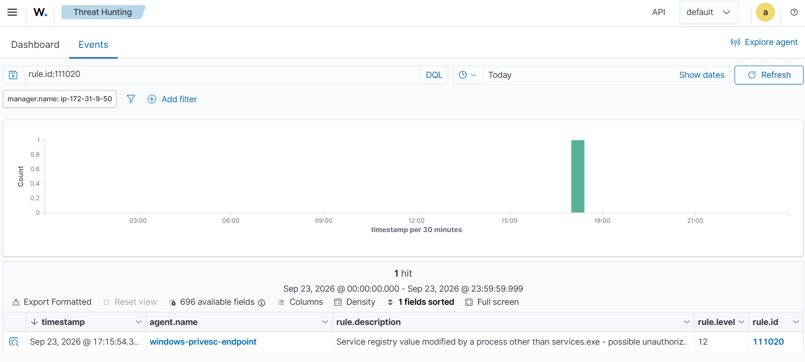
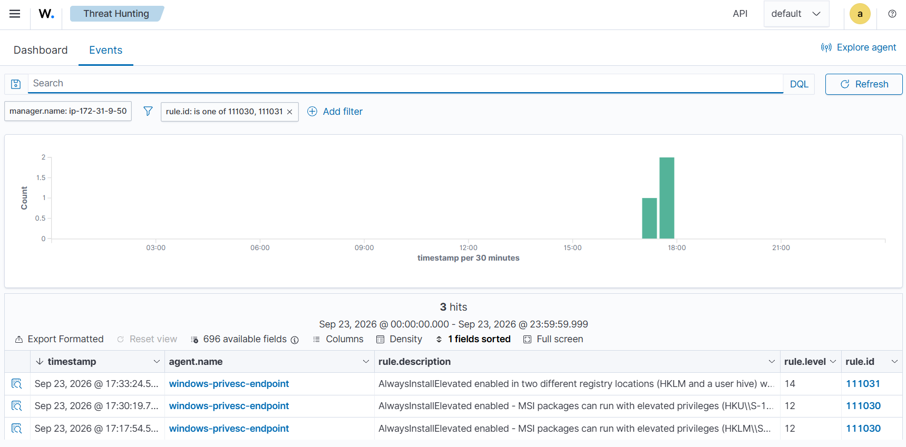
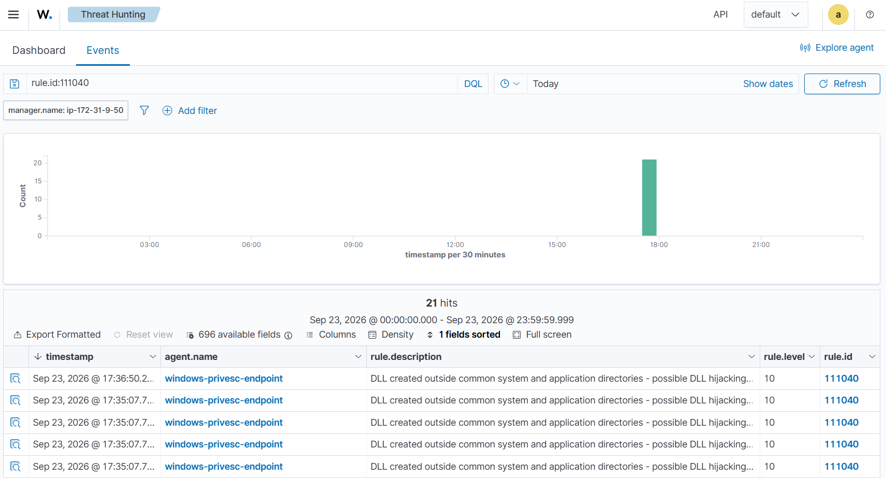
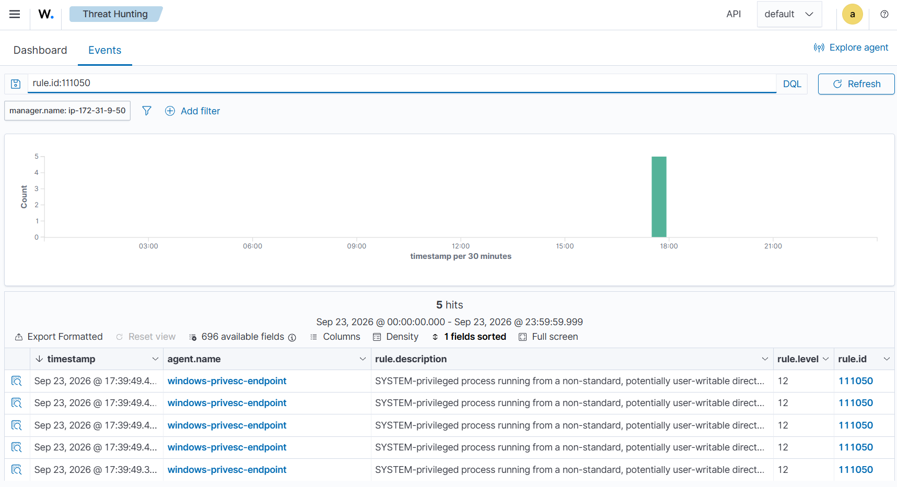

# Detecting Common Windows Privilege Escalation Techniques with Wazuh

## Summary

Privilege escalation is how an attacker turns a standard user foothold into administrator or NT AUTHORITY\SYSTEM control. On Windows, the reliable paths rarely need an exploit. They abuse the platform itself: service configuration, registry permissions, Windows Installer policy, DLL loading behavior, and scheduled tasks. Misconfigure any of them and a standard user can borrow the privileges of the service or task that runs next.

This exercise ran on a Windows endpoint in my lab, monitored with the same Wazuh setup I use for my other detection work: a Wazuh server, a Wazuh agent on the endpoint, and Sysmon feeding process, file, and registry telemetry into it. There is no setup walkthrough here. This write-up is the execution: five privilege escalation techniques, how I ran each one as a standard user, and the custom Wazuh rule that caught it. Each technique is mapped to MITRE ATT&CK.

One note on the screenshots: I did not save captures from my own dashboard during this run, so the alert images below are example captures of the same alerts these techniques produced, included so each detection can be seen the way it appears in the dashboard.

The five techniques:

| # | Technique | ATT&CK | Wazuh rule |
|---|---|---|---|
| 1 | Unquoted service path | T1574.009 | 111010 |
| 2 | Services registry permissions weakness | T1574.011 | 111020 |
| 3 | AlwaysInstallElevated abused through Msiexec | T1218.007 | 111030, 111031 |
| 4 | DLL search-order hijacking | T1574.001 | 111040 |
| 5 | Scheduled task binary replacement | T1053.005 | 111050 |

## 1. Unquoted service path (T1574.009)

When a service ImagePath contains spaces and is not wrapped in quotes, Windows tries each path segment in order before it reaches the real executable. A service pointing at C:\Tools\Vulnerable Path\svc.exe can be intercepted by a binary placed at C:\Tools\Vulnerable.exe. If a standard user can write to that earlier location, the service runs the user's binary with the service account's privileges.

### How I ran it

I created a standard user, gave that user modify rights on C:\Tools, and registered a deliberately vulnerable service with an unquoted path containing a space:

```
> sc.exe create VulnUpdater binPath= "C:\Tools\Vulnerable Path\svc.exe" start= demand
```

Signed in as the standard user, I copied a stand-in binary into the interception point and then had the service started:

```
> Copy-Item "C:\Windows\System32\cmd.exe" "C:\Tools\Vulnerable.exe"
> sc.exe start VulnUpdater
```

### How Wazuh caught it

This detection fires on the misconfiguration itself, at the moment it is introduced. Rule 111010 watches Sysmon Event ID 13 (registry value set) for a service ImagePath being written with an unquoted path that contains a space:

```xml
<rule id="111010" level="10">
  <if_group>sysmon_event_13</if_group>
  <field name="win.eventdata.targetObject" type="pcre2">(?i)\\+Services\\+[^\\]+\\+ImagePath$</field>
  <field name="win.eventdata.details" type="pcre2">^[^"]*\s[^"]*\.exe</field>
  <description>Service ImagePath set to an unquoted path containing a space - vulnerable to path interception ($(win.eventdata.targetObject) = $(win.eventdata.details)).</description>
  <mitre>
    <id>T1574.009</id>
  </mitre>
</rule>
```

The alert named the service and the exact ImagePath value, so the vulnerable configuration was visible before exploitation even mattered.


## 2. Services registry permissions weakness (T1574.011)

Windows keeps service configuration under HKLM\SYSTEM\CurrentControlSet\Services. If a standard user ends up with write access to a service's key, the user can rewrite ImagePath, FailureCommand, or ServiceDll, and the next service start executes the user's code in the service account context.

### How I ran it

I created a test service, then deliberately granted the standard user full control of its registry key. From the standard user session, one command pointed the service at a binary I controlled:

```
> Set-ItemProperty -Path "HKLM:\SYSTEM\CurrentControlSet\Services\WeakPermSvc" -Name ImagePath -Value "C:\Tools\AccessChk\accesschk64.exe -x"
```

### How Wazuh caught it

Legitimate service changes go through the Service Control Manager, which means services.exe is the process writing these values. Rule 111020, the highest value rule in this set at level 12, alerts when any other process modifies ImagePath, FailureCommand, or ServiceDll:

```xml
<rule id="111020" level="12">
  <if_group>sysmon_event_13</if_group>
  <field name="win.eventdata.targetObject" type="pcre2">(?i)\\+Services\\+[^\\]+\\+(Parameters\\+)?(ImagePath|FailureCommand|ServiceDll)$</field>
  <field name="win.eventdata.image" type="pcre2">(?i)^(?!.*\\+Windows\\+System32\\+services\.exe$).+$</field>
  <description>Service registry value modified by a process other than services.exe - possible unauthorized service configuration change ($(win.eventdata.targetObject) set to $(win.eventdata.details) by $(win.eventdata.image), user $(win.eventdata.user)).</description>
  <mitre>
    <id>T1574.011</id>
  </mitre>
</rule>
```

In my run the alert showed PowerShell as the writing process, with the target value and the user in the description. That combination, a non-SCM process rewriting a service value, is the finding on its own.



## 3. AlwaysInstallElevated through Msiexec (T1218.007)

AlwaysInstallElevated is a Windows Installer policy controlled by registry values under both HKLM and HKCU. When both are set to 1, any user can install MSI packages with SYSTEM privileges, which turns msiexec.exe into a privilege escalation tool: build an MSI that runs your command, install it, and it executes as SYSTEM.

### How I ran it

I set the machine policy value as administrator, then set the same value in the standard user's hive:

```
> Set-ItemProperty -Path "HKLM:\SOFTWARE\Policies\Microsoft\Windows\Installer" -Name AlwaysInstallElevated -Value 1 -Type DWord
> Set-ItemProperty -Path "HKCU:\SOFTWARE\Policies\Microsoft\Windows\Installer" -Name AlwaysInstallElevated -Value 1 -Type DWord
```

### How Wazuh caught it

Two rules work as a pair. Rule 111030 (level 12) fires on the Sysmon Event ID 13 that sets any AlwaysInstallElevated value to 1. Rule 111031 (level 14) is a correlation rule: when 111030 matches two different registry locations within 10 minutes, both halves of the policy are in place and the escalation is actually possible, not just half configured:

```xml
<rule id="111030" level="12">
  <if_group>sysmon_event_13</if_group>
  <field name="win.eventdata.targetObject" type="pcre2">(?i)Policies\\+Microsoft\\+Windows\\+Installer\\+AlwaysInstallElevated$</field>
  <field name="win.eventdata.details" type="pcre2">0x00000001</field>
  <description>AlwaysInstallElevated enabled - MSI packages can run with elevated privileges ($(win.eventdata.targetObject) set by $(win.eventdata.user)).</description>
  <mitre>
    <id>T1218.007</id>
  </mitre>
</rule>

<rule id="111031" level="14" frequency="2" timeframe="600">
  <if_matched_sid>111030</if_matched_sid>
  <different_field>win.eventdata.targetObject</different_field>
  <description>AlwaysInstallElevated enabled in two different registry locations (HKLM and a user hive) within 10 minutes - both required values are now set, so any user can install an MSI package with SYSTEM privileges.</description>
  <mitre>
    <id>T1218.007</id>
  </mitre>
</rule>
```

The correlation is the useful part. A single hive value is a policy change worth logging. Both values together are a working escalation path, and the level 14 alert says exactly that.



## 4. DLL search-order hijacking (T1574.001)

When an application loads a DLL by name instead of by full path, Windows walks a search order of directories to find it. A writable directory early in that order lets a standard user plant a DLL that a more privileged application will load and execute.

### How I ran it

I compiled a small loader that loads somelibrary.dll by name, gave the standard user execute rights on the loader and write rights on C:\Tools, then, as the standard user, compiled a decoy DLL into that same directory and ran the loader:

```
> Add-Type -TypeDefinition $dllSource -OutputAssembly "C:\Tools\somelibrary.dll" -OutputType Library
> C:\Tools\DllLoadTest.exe
```

The loader picked up the planted DLL from C:\Tools, which is the whole technique: whoever controls the directory controls the code the application runs.

### How Wazuh caught it

The detection watches the preparation step. Rule 111040 uses Sysmon Event ID 11 (file created) and ignores DLLs created in the standard system and application directories. A DLL appearing somewhere like C:\Tools is the staging behavior that precedes a hijack:

```xml
<rule id="111040" level="10" frequency="2" timeframe="180">
  <if_group>sysmon_event_11</if_group>
  <field name="win.eventdata.targetFilename" type="pcre2">(?i)\.dll$</field>
  <field name="win.eventdata.targetFilename" type="pcre2">(?i)^(?!.*\\+(Windows\\+System32|Windows\\+SysWOW64|Program Files|Program Files \(x86\)|ProgramData\\+Microsoft\\+Windows Defender)\\+).+$</field>
  <description>DLL created outside common system and application directories - possible DLL hijacking activity ($(win.eventdata.targetFilename) by $(win.eventdata.user)).</description>
  <mitre>
    <id>T1574.001</id>
  </mitre>
</rule>
```

Catching the staging matters because once the privileged application loads the DLL, the execution itself can look legitimate. The file creation is where the technique is loudest.



## 5. Scheduled task binary replacement (T1053.005)

A scheduled task that runs as SYSTEM is only as safe as the binary it points at. If that binary lives in a directory a standard user can write to, the user replaces it, waits for the task, and gets SYSTEM execution.

### How I ran it

I created a task named SystemMaintenance running a benign binary from C:\Tools as SYSTEM with the highest run level, then granted the standard user modify rights on C:\Tools. As the standard user I deleted the original binary and compiled a replacement at the same path, then triggered the task:

```
> Remove-Item "C:\Tools\maint.exe" -Force
> Add-Type -TypeDefinition $hijackSource -OutputAssembly "C:\Tools\maint.exe" -OutputType ConsoleApplication
> schtasks.exe /run /tn "SystemMaintenance"
```

The replacement ran and reported itself as running under the SYSTEM account.

### How Wazuh caught it

This rule detects the outcome rather than the setup. Rule 111050 watches Sysmon Event ID 7 (image loaded, which carries the process image and user) for processes running as NT AUTHORITY\SYSTEM from outside the standard system and application directories:

```xml
<rule id="111050" level="12">
  <if_group>sysmon_event7</if_group>
  <field name="win.eventdata.user" type="pcre2">(?i)^NT AUTHORITY\\+SYSTEM$</field>
  <field name="win.eventdata.image" type="pcre2">(?i)^(?!.*\\+(Windows|Program Files|Program Files \(x86\)|ProgramData\\+Microsoft\\+Windows Defender)\\+).+$</field>
  <description>SYSTEM-privileged process running from a non-standard, potentially user-writable directory - possible exploitation of weak permissions on a scheduled task, service, or similar SYSTEM-run mechanism ($(win.eventdata.image)).</description>
  <mitre>
    <id>T1053.005</id>
  </mitre>
</rule>
```

A SYSTEM process executing out of C:\Tools is almost never legitimate, and because the rule keys on the outcome, it also catches the same weak-permission pattern reached through a service or another SYSTEM-run mechanism, not just this task.



## Results

All five techniques alerted in the Wazuh dashboard, searchable in Threat Hunting by rule ID:

| Rule | Level | What it proves |
|---|---|---|
| 111010 | 10 | A service was configured with an unquoted path containing a space |
| 111020 | 12 | A process other than services.exe rewrote a service configuration value |
| 111030 | 12 | AlwaysInstallElevated was set to 1 in one registry location |
| 111031 | 14 | Both AlwaysInstallElevated values were set, completing the escalation path |
| 111040 | 10 | A DLL was staged outside the standard system and application directories |
| 111050 | 12 | A SYSTEM process executed from a non-standard, user-writable directory |

## Detection takeaways

- Privilege escalation on Windows is mostly misconfiguration, and misconfigurations are written to the registry and the file system before they are abused. Sysmon Event IDs 11 and 13 caught three of the five techniques at the preparation stage.
- The strongest detections in this set key on who made the change, not just what changed. services.exe rewriting a service value is administration. PowerShell doing it from a standard user session is an incident.
- Correlation turns weak signals into strong ones. One AlwaysInstallElevated value is a note. Both values inside ten minutes is a working SYSTEM escalation, and the rule severity should say so.
- Outcome detection is the safety net. A SYSTEM process image starting outside the standard directories catches the scheduled task abuse and would catch the same end state reached through paths the preparation rules missed.

## Hardening follow-up

- Quote every service ImagePath, and audit for unquoted paths with spaces during builds.
- Review permissions on service registry keys; standard users should never hold write access.
- Keep AlwaysInstallElevated unset in both hives; it should not appear outside a managed software deployment design.
- Keep application binaries and the DLLs they load out of user-writable directories.
- Audit scheduled tasks that run as SYSTEM and confirm every binary they execute lives somewhere standard users cannot write.
